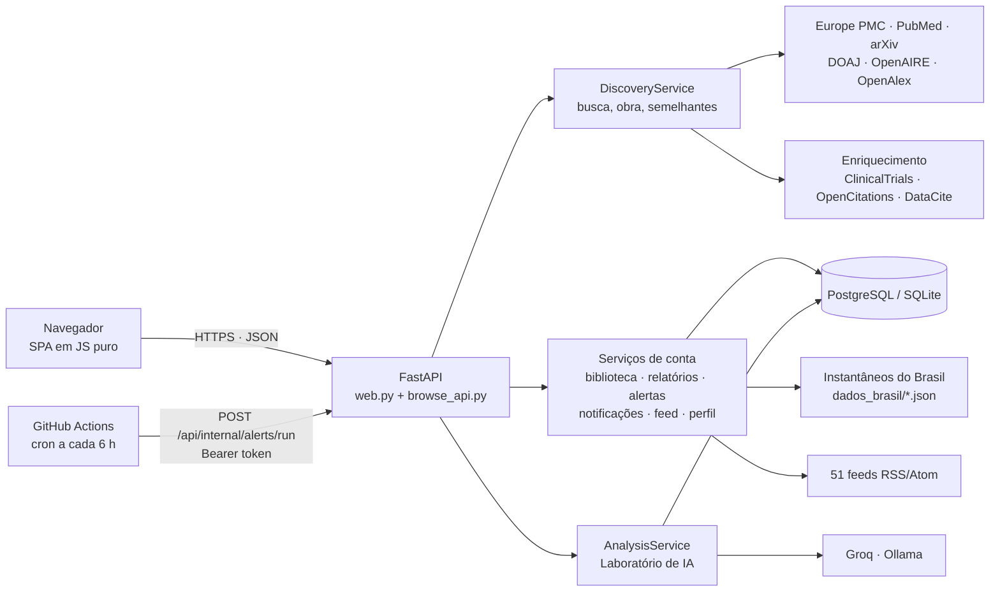
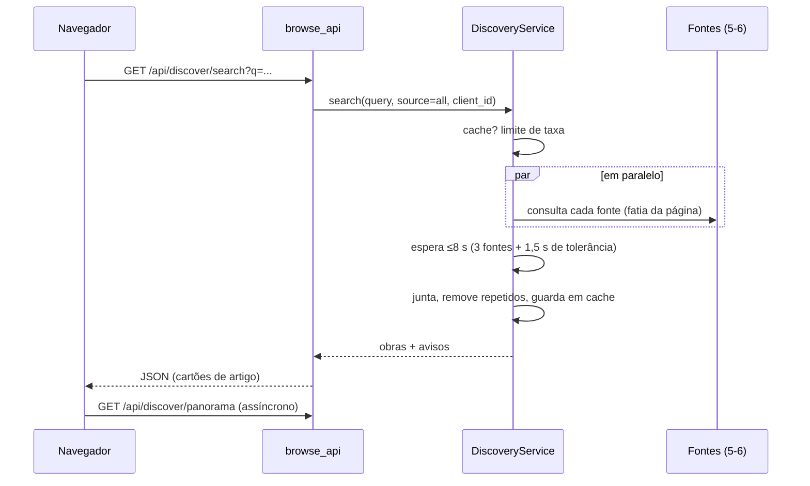
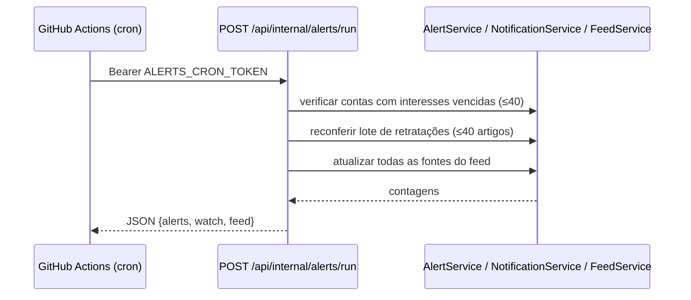

# Arquitetura: visão geral

## Resumo
Aplicação web monolítica em **Python 3.11 + FastAPI**, com front-end próprio em **JavaScript puro** (SPA com roteamento por hash) servido pelo mesmo processo. Persistência em **PostgreSQL** (produção) ou **SQLite** (desenvolvimento) com o mesmo SQL. Sem fila, sem cache externo e sem dependências de front-end: um único serviço web mais uma rotina agendada que chama uma rota protegida.

## Princípios de projeto
1. **Núcleo sem IA.** Busca, extração, nota, citações, relatórios, alertas e feed são determinísticos e testáveis. O LLM fica atrás de uma interface (`LLMBackend`) e só serve o Laboratório de IA (ADR-001, ADR-005).
2. **Camadas com dependência para dentro** (ADR-004): `domain`/`catalog` (tipos) ← serviços (`discovery`, `workflow`, `reports`, `alerts`…) ← rotas (`web`, `browse_api`, `account_routes`) ← entrada (`biomedical_data_digger.py`). Os serviços não conhecem FastAPI.
3. **Falha isolada.** Cada fonte externa falha sozinha (aviso, não erro); a busca só falha se todas falharem; enriquecimento, panorama e semelhantes são "melhor esforço".
4. **Dados oficiais como instantâneos.** ANVISA, Conitec e Rename são arquivos versionados; nenhuma consulta de usuário depende da disponibilidade desses sites.
5. **Segurança por padrão** (ADR-005): CSP restritiva, limites de entrada, proteção contra SSRF, defesa contra injeção de prompt, limitadores de taxa e cotas.
6. **Simplicidade operacional.** Um processo, um banco, configuração por variáveis de ambiente.

## Componentes
| Camada | Módulos principais | Responsabilidade |
|---|---|---|
| Entrada | `biomedical_data_digger.py` | Monta as dependências e sobe o `uvicorn` |
| Web/API | `web.py`, `browse_api.py`, `account_routes.py` | Rotas, middleware de segurança, sessão, tratamento de erros |
| Descoberta | `discovery.py`, `*_catalog.py`, `enrichment.py`, `search_overview.py`, `downloads.py`, `citations.py`, `exports.py` | Busca, junção, obra, semelhantes, enriquecimento, documentos |
| Qualidade | `extraction.py`, `reliability.py` | Trechos do resumo e nota de confiabilidade |
| Pessoal | `library_store.py`, `reports.py`, `report_brasil.py`, `profiles.py`, `interests.py` | Dados da conta |
| Acompanhamento | `alerts.py`, `notifications.py`, `feed.py`, `feed_sources.py` | Alertas, sininho, feed |
| Brasil | `brasil/`, `dados_brasil/`, `contexto_brasil.py` | Bases oficiais e ligação artigo → substância |
| IA (opcional) | `workflow.py`, `llm_service.py`, `pages.py`, `prompt_*.py`, `generation.py`, `grounding.py`, `injection.py`, `quota.py`, `usage.py` | Laboratório de IA |
| Infra | `config.py`, `db.py`, `cache.py`, `ratelimit.py`, `sessions.py`, `security.py`, `xmlutil.py` | Utilidades transversais |
| Front-end | `static/`, `templates/` | SPA e páginas |

Catálogo completo em [Módulos](modulos.md).

## Fluxos principais

### Busca em todas as fontes

### Alertas e avisos (sem navegador aberto)

### Laboratório de IA
Navegador → `web.py` (valida modelo e filtros) → `AnalysisService.analyze` → resolve artigo (cache) → defesa de injeção → `requires` (bloqueio sem IA) → prompt → LLM (Groq/Ollama) → verificação de números → avisos → cache do resultado e registro de consumo.

## Concorrência e estado
- **Servidor ASGI** (`uvicorn`, um processo). Rotas síncronas rodam em *threadpool*; buscas em paralelo e atualização de feeds usam `ThreadPoolExecutor`.
- **Estado em memória por processo:** caches (`TTLCache` de busca 10 min, obras 1 h, enriquecimento, existência de conta 30 s, candidatos do feed 30 s), limitadores de taxa, cotas de tokens, estatísticas de uso. **Reiniciar ou escalar para mais instâncias zera/duplica esse estado.** Por isso o produto, hoje, deve rodar com uma instância (ver [Roadmap](../roadmap/roadmap.md)).
- **Estado durável:** só no banco (contas, biblioteca, listas, relatórios, alertas, notificações, feed, perfis).
- **Travas:** a atualização do feed e a rotina de alertas usam travas por processo para uma execução por vez.

## Persistência
`db.py` abstrai SQLite e PostgreSQL com o mesmo SQL (`?` vira `%s` em PostgreSQL). Cada módulo cria suas tabelas com `CREATE TABLE IF NOT EXISTS` em `initialize()`; não há migrações versionadas (mudanças são aditivas). Detalhes em [Modelo de dados](dados.md).

## Observabilidade
- Logs estruturados com `loguru` (nível `info`); uma linha por chamada de LLM com tokens, modelo, botão e tipo de cliente (sem conteúdo).
- `GET /healthz` para o health check do Render.
- `GET /api/admin/usage` (Bearer `ADMIN_TOKEN`) com o consumo agregado do Laboratório.
- Não há métricas externas nem rastreamento; ver [Runbook](../operacao/runbook.md).

## Decisões registradas
[ADR-001](../adrs/ADR-001-llm-backend.md) backends de LLM · [ADR-002](../adrs/ADR-002-render-deploy.md) deploy no Render · [ADR-003](../adrs/ADR-003-streaming-revertido.md) streaming revertido · [ADR-004](../adrs/ADR-004-arquitetura-em-camadas.md) camadas · [ADR-005](../adrs/ADR-005-seguranca-e-fidelidade.md) segurança e fidelidade · [ADR-006](../adrs/ADR-006-substituicao-do-gradio.md) fim do Gradio · [ADR-007](../adrs/ADR-007-navegador-de-artigos.md) navegador de artigos.
